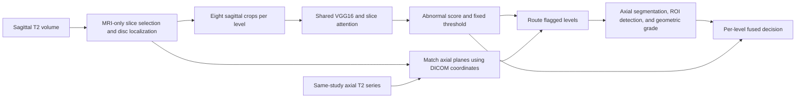

# Lumbar MRI sagittal–axial pipeline

Research prototype for per-disc **normal versus possible bulging/herniation**
screening from sagittal T2 MRI, followed by matched axial analysis and geometric
grading. The sagittal classifier is a fine-tuned VGG16 with attention over eight
slices. Its box locates a disc; it does not outline a herniation.

Start with the [teammate setup and code guide](docs/TEAM_GUIDE.md). It explains
setup, repository structure, checkpoints, commands, result fields, and dataset
adaptation. The [prepared-stack interface](docs/handoff/README.md) supports
integration with another sagittal preprocessing adapter.

## Architecture



The paired runner supports axial grading at **L3–L4, L4–L5, L5–S1**.
Sagittal output covers five levels when visible. Missing axial results remain
indeterminate. The Mendeley runner is a dataset adapter, not a universal
DICOM-folder reader.

## Quick start

Python 3.14.4 was used for the current evaluation. Install a suitable PyTorch
build and the [pinned dependencies](requirements-inference.txt), then run:

```bash
python -m scripts.check_pipeline_artifacts
python -m scripts.run_paired_sagittal_axial \
  --patient-id 1 --device cuda --serial \
  --output outputs/my_paired_run/patient_0001
```

Selected checkpoints, calibration, and evaluation records are committed for
teammate use. Obtain raw datasets separately. The command above requires
`data/raw/mendeley_lumbar/MRI_Data.zip`. The guide also provides a synthetic
smoke test that needs no MRI data.

## Measured results and limits

| Evaluation | Result | Interpretation |
|---|---|---|
| Sagittal attention VGG16, SPIDER training OOF | AP 0.912 | Patient folds; used during development |
| Sagittal attention VGG16, reused SPIDER validation | AP 0.930 | 188 discs; exploratory |
| Paired system, Mendeley images + LSMA labels | F1 0.709, precision 0.584, sensitivity 0.902 | 945 decided discs out of 1,030, two lower levels |
| Same paired evaluation, including unresolved abnormal cases in recall denominator | Sensitivity 0.847 | 431 detected out of all 509 labelled abnormal discs |
| Five-level RSNA axial matching | Top-three exact reference slice 0.855 | 7,390/8,639 eligible levels; matching, not diagnosis |

The LSMA evaluation used 515 patients: `None` maps to normal and `Diffuse Bulge`/
`Central Protrusion` to abnormal. There were 85 indeterminate discs. Fused AP is
not reported because fusion emits categorical decisions. These exploratory,
report-labelled results do not validate axial grades or establish independent
clinical accuracy.

See the [versioned output inventory](outputs/README.md) and
[axial source provenance](docs/AXIAL_SOURCE.md). Dataset files, local clinical
cases, patient images, generated crops, and unrelated experiment artifacts
remain local. Historical code and tracked files may still exist in Git; the
active paired entry point is documented above.
