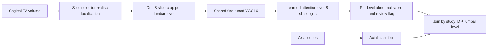

# Sagittal abnormal-disc model: axial integration handoff

For the implemented paired DICOM runner, included checkpoints, fusion rules,
and current evaluation, start with the [teammate guide](../TEAM_GUIDE.md).
This page documents the prepared-stack interface.

This guide is for the teammate integrating a separate axial MRI model. The
sagittal model produces one **normal versus possible bulging or herniation**
score for each available lumbar disc level. The axial model can then classify
the abnormality more specifically. The sagittal model does **not** distinguish
bulging from herniation and its box is a **disc location**, not a lesion box.

## What is ready

- [The attention VGG16 model](../../src/models/attention_vgg16_disc.py) and
  [a preprocessed-stack inference command](../../src/inference/attention_vgg16_stack.py).
- A versioned [threshold and evaluation record](attention_vgg16_calibration.json).
- A [five-level input example](spider_31_t2_input.example.json) and the JSON
  output contract below.

The older local raw-MRI command, `src/inference/abnormal_disc_review.py`,
still loads the lightweight CNN and uses its original slice selector. It is
**not** the attention-VGG16 inference path. The stack command in this guide
starts after localization and crop preparation. A new-data adapter must supply
level-specific stacks in the format below; raw MRI from another dataset cannot
be passed directly to the stack command.

## Architecture and integration



The five level names are exactly `L1-L2`, `L2-L3`, `L3-L4`, `L4-L5`, and
`L5-S1`. Use a study identifier that maps the sagittal and axial series to the
same patient examination. Series names are sequence-specific and are not the
join key. Verify vertebral numbering when the two datasets use different
conventions or a scan has unusual anatomy.

For a first merged evaluation, run both models on **all available levels** and
join the outputs. Serial routing can later send flagged or unavailable levels
to the axial model. A serial gate cannot recover a disc that the sagittal
model falsely clears: it missed 7 of 143 abnormal discs on the reused SPIDER
validation cohort. Treat `unavailable` as missing input, not as normal.

## Included artifacts

| Item | Needed for | Distribution |
| --- | --- | --- |
| `fixed.pt` from `outputs/spider_abnormal_vgg16_attention_guarded_v1/` | Classifier inference | Committed selected output; about 59 MB |
| [Calibration JSON](attention_vgg16_calibration.json) | Fixed review threshold `0.23432311415672302` | Commit with this guide |
| This repository's `src/models/` and `src/inference/attention_vgg16_stack.py` | Loading and scoring prepared stacks | Commit to Git |
| Localizer checkpoint and raw-MRI preprocessing code | Sagittal localization | Included; the paired runner supplies a Mendeley DICOM adapter |

Expected SHA-256 for the current classifier checkpoint:

```text
03fd768aa7b5a7fb3fe21126e3d1bfcb09d89fbaeb85a93820e8c3ac14a6304a  fixed.pt
```

The model loads its saved weights with `pretrained=False`; inference does not
download ImageNet weights. Do not substitute another VGG16 checkpoint or a
threshold from another experiment.

## Environment

Run commands from the repository root. The development environment used Python
3.14 with `torch 2.11.0+cu128`, `torchvision 0.26.0+cu128`, and `numpy 2.5.2`.
For another machine, create a virtual environment and use the
[official PyTorch install selector](https://pytorch.org/get-started/locally/)
for its CPU or GPU build. The stack inference command needs `torch`,
`torchvision`, and `numpy`. Raw `.mha` loading and SPIDER crop generation also
need `SimpleITK` and Pillow; the evaluation and chart scripts use
`scikit-learn` and Matplotlib.

Check the environment:

```bash
.venv/bin/python -c "import torch, torchvision, numpy; print(torch.__version__, torchvision.__version__, numpy.__version__); print('CUDA:', torch.cuda.is_available())"
```

### Fresh-checkout smoke test

After cloning, this checks installation and JSON wiring
without any MRI data. The zero-filled stack is synthetic; its model score has
**no medical meaning**.

```bash
mkdir -p outputs/handoff_smoke
.venv/bin/python -c 'import numpy as np; np.save("outputs/handoff_smoke/blank.npy", np.zeros((8, 1, 160, 160), dtype=np.uint8))'
.venv/bin/python -m src.inference.attention_vgg16_stack \
  --input docs/handoff/smoke_input.example.json \
  --checkpoint outputs/spider_abnormal_vgg16_attention_guarded_v1/fixed.pt \
  --calibration docs/handoff/attention_vgg16_calibration.json \
  --output outputs/handoff_smoke/result.json \
  --device auto
```

The output should use `schema_version: sagittal-review/v1`, have five level
records, and mark four levels unavailable. Run it once with a fresh output
path; the command does not overwrite files.

## Prepared-stack input contract

Each available disc has one `.npy` array of shape **`[8, 1, 160, 160]`** and
dtype **`uint8`**. The eight entries are sagittal slices in scan order. The
runner divides pixel values by 255; the model then repeats grayscale values
across RGB channels and applies its saved ImageNet normalization. Do not apply
that RGB normalization in the input adapter.

The SPIDER crop protocol, which an adapter must match or deliberately
revalidate, is:

1. Choose an MRI-only sagittal localization slice from the middle ±2 slices.
   The guarded selector uses localizer geometry and a level-confidence margin.
2. Localize each disc and assign its lumbar level. The box uses original
   sagittal-image `x1, y1, x2, y2` coordinates.
3. For each level, take slice indices `selected-3` through `selected+4`,
   clipping at volume boundaries. Use the same disc box on all eight slices.
4. Normalize each source slice using the 1st and 99th percentiles of finite,
   positive pixels; crop at scale `1.5` with a `0.25` posterior shift;
   bilinearly resize to `160×160`; zero rows outside the level band.

The SPIDER volume reader first orients its `.mha` image to LPS and flips the
array's first axis. That file-specific transform must be checked against the
new dataset's image orientation. A single slice repeated eight times is an
input-protocol mismatch, not a substitute for a real eight-slice stack.

The input JSON has a study ID, sagittal series name, optional selected slice,
and one entry per available disc. `disc_box_xyxy_original` is optional. See
[the complete example](spider_31_t2_input.example.json):

```json
{
  "study_id": "example-study",
  "sagittal_series_name": "example-sagittal-T2",
  "selected_sagittal_slice": 7,
  "discs": [
    {
      "level": "L4-L5",
      "stack_path": "path/to/L4-L5.npy",
      "disc_box_xyxy_original": [180, 298, 238, 326]
    }
  ]
}
```

Paths in `stack_path` are resolved from the current working directory. Omit
unavailable levels; the output marks them `unavailable`. The input must not
contain ground-truth labels or an axial diagnosis.

## Run the classifier

On the sagittal owner's machine, the following example works when the guarded
SPIDER stacks and the included checkpoint are present:

```bash
.venv/bin/python -m src.inference.attention_vgg16_stack \
  --input docs/handoff/spider_31_t2_input.example.json \
  --checkpoint outputs/spider_abnormal_vgg16_attention_guarded_v1/fixed.pt \
  --calibration docs/handoff/attention_vgg16_calibration.json \
  --output outputs/handoff_31_t2.json \
  --device auto
```

The command refuses to overwrite an existing output. On a new dataset,
replace the example JSON paths with that dataset's prepared stacks and use a
new output path. The model accepts `--device cpu` or `--device cuda` as well.

The output uses schema version `sagittal-review/v1`:

```json
{
  "schema_version": "sagittal-review/v1",
  "study_id": "example-study",
  "sagittal_series_name": "example-sagittal-T2",
  "selected_sagittal_slice": 7,
  "status": "partial",
  "model_kind": "abnormal_disc_vgg16_slice_attention",
  "review_threshold": 0.23432311415672302,
  "review_levels": ["L4-L5"],
  "levels": [
    {
      "level": "L4-L5",
      "status": "available",
      "abnormal_disc_score": 0.989,
      "review_recommended": true,
      "disc_box_xyxy_original": [180, 298, 238, 326],
      "box_coordinate_system": "original sagittal image pixels"
    }
  ]
}
```

This JSON snippet shows the fields consumed by the axial integration. The
actual command emits all five level records, including unavailable levels,
and an `interpretation` string. The score shown above is illustrative; use
the model-generated value from the output file. An available level has a
score and Boolean flag; an unavailable level has null values for both.

The sagittal disc box cannot be used as an axial pixel box. The axial stage
must locate its own axial slice or region and return its own coordinates.
For joining results, use `(study_id, level)` and preserve both models' raw
scores and availability states. An axial result should identify which axial
series it used and whether its level assignment is certain.

## Interpretation and measured limits

The positive class is **bulging OR herniation**. At the fixed threshold, the
attention VGG16 achieved 136 true abnormal flags, 20 false flags on normal
discs, 7 missed abnormal discs, and 25 correctly unflagged normal discs on
188 reused SPIDER validation discs. AP was `0.912` across patient-held-out
training predictions and `0.930` on that reused cohort. These values do not
validate a new dataset. On the different, single-slice LSMA protocol, the
model's AP was `0.414` versus positive prevalence `0.402`. Thus the threshold
and score ranking must be measured again on the target dataset before serial
gating is relied on. The separate axial model's performance is not included
in these numbers.

## Before merging

- Commit this guide, the stack runner, and the calibration copy. Keep raw MRI,
  generated crops, and experimental output directories outside ordinary Git
  commits.
- Verify the included checkpoints with `python -m scripts.check_pipeline_artifacts`.
- Decide the shared study ID and lumbar numbering convention. Keep sagittal
  and axial series IDs separate.
- For an all-level audit, join stage outputs by examination and level.
  The implemented paired runner's `--serial` and `--concurrent` modes route
  flagged supported levels. Missing results remain indeterminate. Concurrent
  mode uses axial level workers after sagittal matching; it does not run the
  sagittal and axial stages simultaneously.
- Test one known stack against the saved score before using another dataset.
  In the local SPIDER example, `31_t2` L4-L5 scores about `0.989` and is
  flagged; its L5-S1 disc is labelled normal but also flagged at about
  `0.951`, illustrating a false alert.
- The older SPIDER raw-MRI command uses the CNN. The new paired Mendeley runner
  integrates attention VGG16 with localization and axial matching. Adapting
  another acquisition format still requires an input adapter and evaluation.
